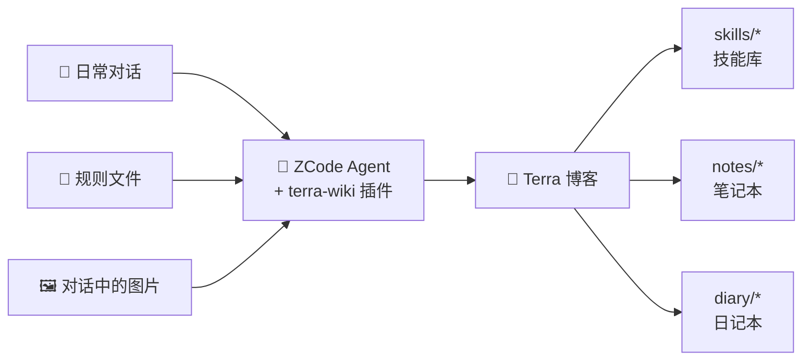

<div align="center">

# 🌿 Zcode-Terra-Plugin

**让 Agent 帮你经营自己的博客 —— 对话进，内容出**

[](https://github.com/JeffreyZhu0201/Zcode-Terra-Plugin/actions/workflows/ci.yml)
[](LICENSE)


[](https://github.com/JeffreyZhu0201/Terra-Wiki)

[安装](#-安装) · [用户故事](#-用户故事) · [分类设计](#-分类设计) · [技能一览](#-技能一览) · [参与贡献](CONTRIBUTING.md)

</div>

---

## ✨ 这是什么

**terra-wiki** 是一个 [ZCode](https://zcode.ai) 插件，封装了自托管博客平台 [Terra-Wiki](https://github.com/JeffreyZhu0201/Terra-Wiki) 的 MCP。安装后，你在日常对话中随口说一句：

> "把这段对话沉淀一下" · "记进恋爱日记" · "把 CLAUDE.md 蒸馏成规范"

Agent 就会自动完成：**查重 → 智能分类 → 图片上传 → 询问草稿/发布 → 写入平台**。聊着天，博客就长起来了。



## 📖 用户故事

### 🧪 故事一 · 把一场调试对话，变成可复用的技能库

> 阿杰花了一下午和 Agent 一起排查一个诡异的构建缓存问题，踩了三个坑终于解决。收工时他说："**这套办法值得记下来，下次别再踩一遍。**"

Agent 通读对话，识别出可复用的方法论（而不是流水账），蒸馏成一份**去个性化、自包含**的 SKILL.md 文档：适用时机、前置条件、编号步骤、陷阱、验证方式。查重确认平台上没有同主题文章后，挂在合适的技能分类下——标题即技能名，正文即文档原文，日后自己或任何 Agent 都能直接复制复用。

一场对话解决一个问题；一百场对话，长出一座**个人技能库**：

```
skills/
├── dev/          # 开发方法论：调试、重构、测试
├── writing/      # 写作、文档、表达
└── workflow/     # 工具链、效率、自动化
```

### 📜 故事二 · 把项目里的规则文件，蒸馏成通用规范

> 阿杰的项目里躺着一堆积攒多年的 `CLAUDE.md`、`.cursorrules` 和自定义 skill，每换一个项目就要重新抄一遍。他说："**把这些规则沉淀成规范，传到平台上。**"

Agent 逐个读取规则文件，按主题重组（而不是照抄原文顺序），剥离私有路径和密钥，把"必须 X"补全为"必须 X，因为 Y"——**理由比规则更值得流传**。多文件时先给出批量计划，确认后逐篇上传。

下次开新项目，打开平台复制对应的规范文档，旧项目的经验立刻生效。

### 📝 故事三 · 把零散的讨论，整理成结构化笔记

> 阿杰和 Agent 聊了一个晚上的技术选型：对比了三个方案、贴了架构图、最后拍板了其中一个。他说："**记个笔记，别白聊了。**"

Agent 把对话压缩成 `背景 → 要点 → 决策与结论 → 遗留问题`，对话中的架构图逐张上传到图床并嵌回对应位置，然后按主题挂进笔记本的分类树：

```
notes/
├── tech/         # 技术笔记：选型、原理、踩坑
├── reading/      # 读书与文章笔记
└── life/         # 生活随笔、灵感碎片
```

信息密度优先，寒暄全删。三个月后搜"选型"，当天的决策依据原样都在。

### 💞 故事四 · 把每天的对话，变成恋爱日记

> 阿杰和女朋友异地，每天睡前都会和 Agent 聊几句今天的事：一起云看了一个展、定了周末的旅行、或者只是记住了她随口提到想要的东西。他说："**帮我记进恋爱日记。**"

Agent 以第一人称写下今天的故事，按场景挂进日记本的分类，标题带上日期：

```
diary/
└── love/             # 恋爱日记
    ├── daily/        # 🌤 日常点滴
    ├── date/         # 🎡 约会记录
    ├── anniversary/  # 🎂 纪念日
    └── travel/       # ✈️ 一起旅行
```

- 标题形如 `2026-10-31 第一次一起云看展`，天然按日期归档；
- 打上 `恋爱日记`、`纪念日` 之类的标签，横向检索；
- 纪念日临近时，翻一翻去年今天写了什么——平台按天统计的**发布日历**正好成了你们的回忆时间线。

日记默认存草稿，写给你自己（和你爱的人）看。

## 🗂 分类设计

插件不做死板约定，而是**智能分类 + 与你共同生长**：

1. 优先挂到语义匹配的**现有叶子分类**；
2. 没有合适的，Agent 提议新建（名称 + slug + 父分类），**你确认后才创建**；
3. 发现分类语义重复，Agent 会建议改名/移动，而不是另起炉灶。

上面的三棵分类树（skills / notes / diary）只是推荐起点——你的博客最终长什么样，由你每天聊什么决定。

## 🚀 技能一览

| 技能 / 命令 | 场景 | Agent 会做什么 |
| --- | --- | --- |
| 🧪 `distill-skill`<br>`/distill-skill` | "把这段对话蒸馏成 skill" | 识别可复用方法论 → 产出通用 SKILL.md → 查重 → 智能分类 → 上传 |
| 📜 `distill-rules`<br>`/distill-rules` | "把 CLAUDE.md 沉淀成规范" | 读取规则文件 → 重组、去私有化 → 批量计划 → 逐篇上传 |
| 📝 `conversation-notes`<br>`/conversation-notes` | "记个笔记 / 写篇日记" | 判定笔记或日记模式 → 结构化整理 → 图片上传嵌入 → 上传 |
| 🛠 `wiki-ops` | 所有上传的底层约定 | 预检、智能分类、查重更新、图片管线、发布流程（自动加载） |

## 📦 安装

本仓库根目录即插件根，`marketplace.json` 就放在仓库根——**整个仓库就是一个插件市场**。

1. **添加插件市场**：ZCode 中打开 **插件市场 → 添加 → 添加插件市场**，任选其一：
   - 🌐 直接粘贴仓库地址 `https://github.com/JeffreyZhu0201/Zcode-Terra-Plugin`
   - 📁 或本地克隆后粘贴仓库根目录路径

   ```bash
   git clone https://github.com/JeffreyZhu0201/Zcode-Terra-Plugin.git
   ```

2. **安装插件**：到 **个人** 页，安装 **Terra Wiki 博客助手**

3. **配置**：**设置 → 插件** → 点开 **terra-wiki** 卡片进详情，展开底部 **高级信息**，在 **配置** 区填写：
   - **Terra MCP 服务地址**：默认 `http://localhost:3000/api/mcp`
   - **Terra API Token**：在 Terra 后台签发（默认 Token 只能建草稿；发布需 `can_publish` 权限）

   填完点 **保存配置**，配置值会注入 `.mcp.json` 中的 `${user_config.*}` 占位符。
   - **Terra MCP 服务地址**：默认 `http://localhost:3000/api/mcp`
   - **Terra API Token**：在 Terra 后台签发（默认 Token 只能建草稿；发布需 `can_publish` 权限）

5. **新建任务试试**：选择 terra-wiki 技能，发送"把刚才这段对话蒸馏成一个通用 skill 上传到 Terra"

> 💡 如果之前在 `~/.zcode/cli/config.json` 手工配置过 `terra-wiki` MCP，安装插件后请删除全局旧条目，避免工具重复。

## 🛠 开发

```bash
node scripts/validate-plugin-files.mjs   # 文件级校验（CI 同款）
```

无构建步骤、无依赖。插件是纯声明式的（Markdown + JSON），开发规范、版本同步规则与上游工具同步流程见 [AGENTS.md](AGENTS.md)。

## 🤝 参与贡献

欢迎 Issue 和 PR！提交前请阅读 [CONTRIBUTING.md](CONTRIBUTING.md)——分支命名、Conventional Commits、版本同步、上游工具对齐，都写在里面了。

## 📄 License

[MIT](LICENSE) © Jeffrey Zhu
